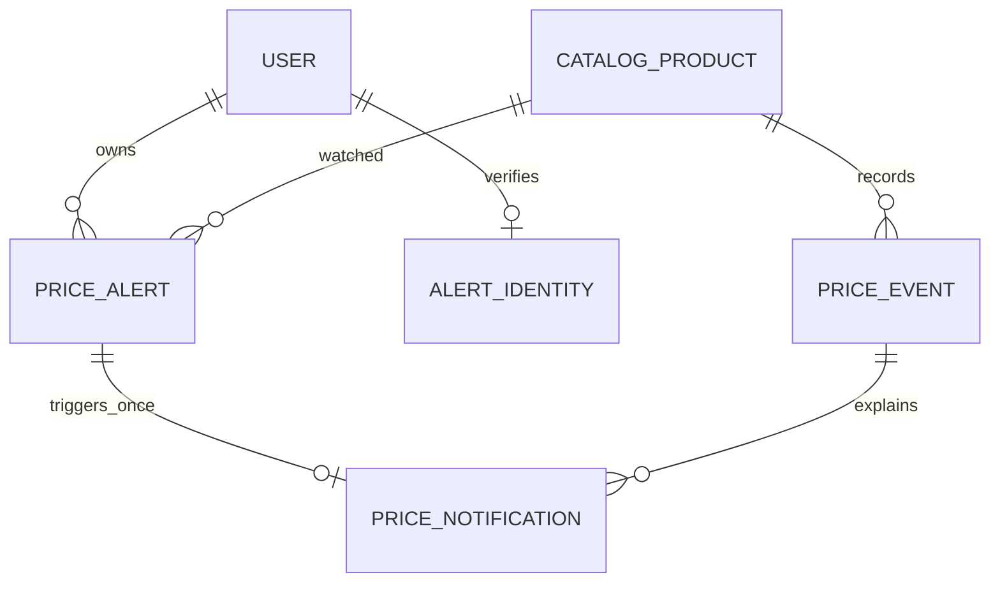

# DESYR price drop alerts backend

This is the price-alert module for the existing React magazine website. It does not implement cart, checkout, payments, registration or orders. It uses Django's existing user model and a small product-price mirror that an official catalog integration must populate.

The frontend on GitHub Pages defaults to an explicitly labelled **browser preview**. Preview alerts and simulated price events stay in that browser and never send email. Setting `VITE_PRICE_ALERT_API_URL` connects the same interface to this backend; failed API calls never silently fall back to local preview storage.

## Local setup

Use Python 3.12. From the project root, create a virtual environment if one is not already present:

```powershell
python -m venv backend/.venv
backend/.venv/Scripts/python.exe -m pip install -r backend/requirements.txt
Copy-Item backend/.env.example backend/.env
backend/.venv/Scripts/python.exe backend/manage.py migrate
backend/.venv/Scripts/python.exe backend/manage.py seed_catalog
backend/.venv/Scripts/python.exe backend/manage.py createsuperuser
backend/.venv/Scripts/python.exe backend/manage.py runserver 127.0.0.1:8000
```

Generate a unique `DJANGO_SECRET_KEY` and put it in the ignored `backend/.env` so sessions survive restarts. The development fallback generates an ephemeral key; production refuses to start without a key. Leave SMTP disabled for local review. SQLite and eager Celery execution are development conveniences only.

`seed_catalog` imports 24 demonstration product snapshots and never overwrites existing prices. It refuses to run with `DJANGO_DEBUG=0`. Every imported product has `is_live=False`. It is not a price scraper or an official live feed.

In another terminal, connect a frontend preview:

```powershell
$env:VITE_PRICE_ALERT_API_URL='http://localhost:8000/api/price-alerts'
npm.cmd run dev -- --host 127.0.0.1 --port 5174
```

Open `http://localhost:5174`. Create customer accounts through your existing identity system or Django admin. Confirm their email ownership, then enable their **Alert identity / email verified** flag in Django admin. Verification is bound to that exact address. After an email change, clear/save the flag and confirm the replacement address before enabling it again. The frontend provides sign-in/sign-out; it does not create a duplicate registration system. Test identities must use addresses such as `customer@example.invalid` and remain development-only.

## Customer workflow

1. Open a product and choose **Notify me of a price drop** beside its price.
2. Select 10, 20, 30, 40 or 50 percent. The server computes the target from its official reference price.
3. Use the bell icon to view alerts, edit discounts, pause/resume, delete, or inspect history.
4. An authorized price change creates a persisted event. Celery evaluates eligible customer alerts, records one notification per alert, and queues delivery.
5. A triggered alert stays triggered after further drops, rebounds or preference edits. A new notification cycle requires an explicit new alert.

Browser preview exposes a labelled **Simulate target price** button. It only changes preview data, never the real product catalog. API mode has no customer-facing official-price editor or simulation button.

## API

All routes are under `/api/price-alerts/`. Mutations require Django session authentication and a valid CSRF token, except that login itself is anonymous but still CSRF-protected. `GET session/` returns a token; pass it as `X-CSRFToken` and include credentials. Production CORS/CSRF origins must be explicit.

| Method and path | Purpose |
| --- | --- |
| GET `session/` | Session, CSRF token, verified-email flag and delivery mode |
| POST `login/` | Existing account username/password |
| POST `logout/` | End the session |
| GET `products/` | Server-held product prices and live-source flags |
| GET `alerts/` | Only the current customer's alerts and history |
| POST `alerts/` | `{productId, discount, requestId}`; requestId is a UUID reused on retries |
| POST `alerts/<uuid>/` | `{action: edit/pause/resume/delete, discount?}` |
| POST `products/<external-id>/price/` | Authorized price operator only: `{kind: selling/reference, price: "1200.00", reason: "..."}` |

The API ignores client-submitted reference/target prices. Prices are Decimal values on the server, rounded to two decimal places with `ROUND_HALF_UP`. Responses use integer minor units (`referenceCents`, `currentCents`, `targetCents`) for exact frontend display and calculations. Valid discounts are enforced in application logic and database constraints. Authentication and write endpoints have rate limits.

## Price and notification rules

- A new alert snapshots the catalog's official reference/base price, distinct from its current selling price. Customer threshold edits do not change that snapshot.
- Authorized reference-price changes update ACTIVE and PAUSED alerts and recalculate their targets without changing their percentages. These changes are audited and never send email by themselves. Earlier queued events are excluded after this policy change.
- Selling-price changes record immutable snapshots. A brief discount followed by a rebound is not lost while the worker is waiting.
- ACTIVE and PAUSED alerts reserve a nullable unique customer/product key. TRIGGERED and CANCELLED alerts release the key. This supports MySQL without relying on unsupported partial unique indexes.
- Notification events have a unique alert relationship. Row locks, conditional state changes and creation request IDs protect retries and concurrent submissions.
- Deletion is cancellation; notification history is retained. Customers cannot read or mutate another customer's alerts.
- Price events form a database outbox. A broker failure leaves recoverable work rather than dropping the event.

## Email delivery

`PRICE_ALERT_DELIVERY_MODE=preview` records **PREVIEW**, never **SENT**, and never invokes SMTP. Real sending requires `smtp`, a verified customer email, and a product marked `is_live` after its official price integration has been connected. Notifications created as previews never silently become live mail later.

Emails have HTML and plain-text alternatives, product image/link, reference price, selected threshold, target, selling price at notification and actual discount. SMTP acceptance is recorded as SENT; it is not proof of inbox delivery.

Known rejected temporary failures retry the same notification up to five attempts. A persisted SENDING claim prevents competing workers from sending twice. Ambiguous SMTP disconnects become UNKNOWN and are not blindly resent; an operator must reconcile them with the provider. Plain SMTP cannot guarantee exactly-once inbox delivery across a crash after acceptance. A provider with idempotent delivery APIs is needed to strengthen that guarantee.

Celery beat reconciles the persisted outbox every five minutes. This does not poll brand websites. It requeues missed price events and safe retries, and marks expired delivery claims UNKNOWN. It can also be run manually:

```powershell
backend/.venv/Scripts/python.exe backend/manage.py reconcile_price_alerts
```

## Official catalog integration

`CatalogProduct.external_id` maps to the existing frontend product IDs. This is a minimal price mirror, not a replacement product-management system. Connect a trusted vendor feed or your team's product-price update code to `price_alerts.services.update_price`. The actor must have `price_alerts.change_catalogproduct`; the service records the audit event and dispatches only after a successful database commit. Never accept customer-supplied selling/reference prices.

The integration must identify products consistently and distinguish selling prices from authorized reference-price revisions. Mark `is_live=True` only once those prices really come from an official source. No brand feed or credentials have been supplied, so no external brand-monitoring connection is active.

## Production deployment

The backend is not deployable to GitHub Pages. It needs a Python host, MySQL, Redis, Celery worker, Celery beat, HTTPS and an SMTP provider with a verified sender. Keep credentials in environment variables; do not expose them in Vite variables.

`Dockerfile` and `compose.yaml` package the services. Copy `.env.example`, configure all service credentials, set `DJANGO_DEBUG=0`, `CELERY_TASK_ALWAYS_EAGER=0`, real allowed hosts/origins, and a strong secret. Enable SMTP only after provider/domain setup and verified customer identities. The web port binds loopback by default; place a trusted HTTPS reverse proxy in front. Set `TRUST_HTTPS_PROXY=1` only behind that trusted proxy. Serve collected admin static files through the host/proxy.

```text
docker compose up --build -d db redis
docker compose run --rm web python manage.py migrate
docker compose run --rm web python manage.py createsuperuser
docker compose up -d web worker scheduler
```

Use a same-site custom frontend/API domain or a reverse proxy for reliable session cookies. A separate backend domain used with `github.io` can be affected by third-party cookie blocking; `SameSite=None` alone is not a universal fix. Set the frontend `VITE_PRICE_ALERT_API_URL` to the hosted HTTPS API and rebuild it. Its magazine layout and GitHub Pages frontend can remain intact.

## Verification

```powershell
backend/.venv/Scripts/python.exe backend/manage.py test price_alerts --settings=desyr_backend.test_settings
backend/.venv/Scripts/python.exe backend/manage.py makemigrations --check --dry-run
backend/.venv/Scripts/python.exe backend/manage.py check
npm.cmd run test:alerts
npm.cmd run test:size
npm.cmd run build
```

Executed locally: 24 Django tests, **23 passed and 1 skipped**. The skipped test requires a running MySQL database and checks concurrent workers; it must be run before live deployment. Tests cover discount validation/rounding, independent targets, fixed references, ownership, CSRF, administrator permissions, trigger boundaries, pause/resume/delete, rebounds, idempotency, email alternatives and safe/ambiguous retry states. Sending tests use Django's in-memory mail backend, not real recipients. Production password hashing is untouched by the fast test-only hasher.

Browser checks passed for all magazine themes and mobile layout, alert management, persistence, history, modal focus and keyboard isolation. The local React-to-Django integration passed sign-in, server-priced creation, operator price changes, one recorded event after multiple drops/rebounds, private customer history and logout. SMTP sending, Docker services, Redis-backed worker operation and the MySQL concurrency test have not been exercised against production services on this machine.



The production configuration check also runs without service connections. HSTS is limited to the API hostname; subdomain and preload flags remain off until the deployment owner confirms domain-wide HTTPS. Django therefore reports W005/W021 for those deliberate domain-policy choices.
